<!-- ╔════════════════════════════════════════════════════════════════╗
     ║  Gabriel Inácio · profile README · noir-neon "code editor" theme ║
     ║  Assets in /assets · SVGs generated, fonts embedded (JetBrains)   ║
     ╚════════════════════════════════════════════════════════════════╝ -->

<div align="center">

<a href="https://inaciodev.online"></a>

<br/>


<p>
  <a href="https://inaciodev.online"></a>
  <a href="https://www.linkedin.com/in/gabriel-in%C3%A1cio-rodrigues-silva-072029220/"></a>
  <a href="mailto:gabrielinaciodev47@gmail.com"></a>
  <a href="https://rumor.inaciodev.online"></a>
  
</p>

</div>

<br/>

<div align="center"></div>

> I don't just *call* an LLM API — I build systems around them: **multiple agents working in parallel**, **MCP** tools, **local models running in containers**, and **AI wired straight into the OS and real processes**. The model interprets; the code decides.

<table>
<tr>
<td width="50%" valign="top">

**🧠 How I work with AI**
- **Multi-agent orchestration** — coordinating several AI agents/fronts on one goal, each with its own context & tools
- **MCP (Model Context Protocol)** — custom tools & servers that give agents real capabilities
- **Local models, self-hosted** — Hugging Face embeddings + **Ollama** LLMs running in **Docker containers**, no API bill, fully offline
- **AI integrated into the machine** — desktop/OS automation, pipelines and day-to-day processes driven by AI
- **LLMs in production** — OpenAI (GPT-4, Whisper), Gemini: prompt design, context management, reliable **structured outputs**
- **AI-assisted engineering** — Claude Code & Codex as part of the daily workflow

</td>
<td width="50%" valign="top">

**⚙️ The toolbox**

```ts
const stack = {
  agents:   ["multi-agent orchestration", "MCP tools"],
  localLLM: ["Hugging Face", "Ollama", "ONNX"],
  runtime:  ["Docker", "containers", "Linux"],
  cloudLLM: ["OpenAI GPT-4 / Whisper", "Gemini"],
  patterns: ["RAG", "embeddings", "structured output",
             "prompt design", "context mgmt"],
  rule:     "the model interprets, the code decides",
}
```

</td>
</tr>
</table>

#### 🚀 AI projects

<table>
<tr>
<td width="50%" valign="top">
<a href="https://inaciodev.online">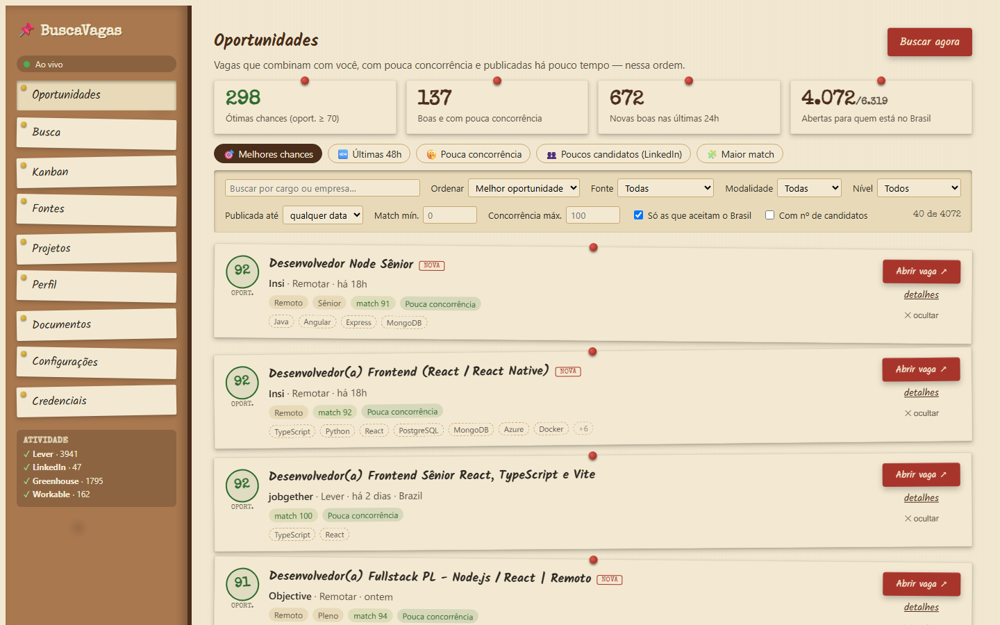</a>
<b>BuscaVagas</b> — <sub>🔒 private</sub><br/>
<sub>AI job-hunting engine. <b>Local Hugging Face embeddings</b> rank thousands of jobs by real fit; the best go to an LLM. Multi-source scraping, a <b>realtime</b> dashboard (WebSockets), tailored résumés + cover letters, and an apply-assist agent. Runs 100% local via Docker — works with no API key.</sub><br/>
<sub><code>TypeScript</code> · <code>Nuxt</code> · <code>Fastify</code> · <code>BullMQ</code> · <code>HF Transformers</code> · <code>Postgres</code> · <code>Docker</code></sub>
</td>
<td width="50%" valign="top">
<a href="https://rumor.inaciodev.online"></a>
<b>LÁBIA</b> — <sub>🔒 private</sub><br/>
<sub>Co-op comedy <b>heist game you play with your real voice</b>. NPCs are driven by a <b>local LLM</b> + speech-to-text: they understand what you say, get annoyed, remember, and call security. Runs offline, in PT/EN/ES. The AI acts; the code rules.</sub><br/>
<sub><code>Godot</code> · <code>Local LLM</code> · <code>Whisper/STT</code> · <code>multiplayer</code></sub>
</td>
</tr>
<tr>
<td width="50%" valign="top">
<b>🛡️ InacioCyber</b> — <sub>🔒 private</sub><br/>
<sub>An <b>autonomous pentest agent that runs 100% locally</b> (Qwen via Ollama). You chat in a terminal-style UI, declare a target <b>you own or are authorized to test</b>, and the agent chains real security tooling for recon, enumeration and code-repo auditing. Authorized, offline, educational by design.</sub><br/>
<sub><code>Python</code> · <code>Ollama</code> · <code>Qwen</code> · <code>Docker</code> · <code>security tooling</code></sub>
</td>
<td width="50%" valign="top">
<b>🎙️ FormataAI</b> — <sub><a href="https://github.com/GabrielInacior/FormataAI">repo</a></sub><br/>
<sub>Mobile app that turns a voice recording into a formatted message, document or summary — <b>Whisper</b> transcription + <b>GPT-4</b> with careful prompt design for consistent structured output. Built as my final graduation project (TCC).</sub><br/>
<sub><code>Flutter</code> · <code>OpenAI Whisper</code> · <code>GPT-4</code> · <code>Node.js</code> · <code>AWS</code></sub>
</td>
</tr>
</table>

<div align="center"></div>

<div align="center"></div>

> **4+ years** building web, mobile, desktop and backend systems that actually reach production — with an ownership mindset that goes past writing code, into architecture, delivery and the people side.

<table>
<tr>
<td width="55%" valign="top">

**🏛️ What I bring**
- **Core developer & tech lead** at a SaaS company in the Brazilian **public-procurement** sector — led a 3-dev team across **6+ large-scale projects**, owning architecture and sprint planning
- Original developer of **ACL (Public Bidding Assistant)** — automating the full procurement lifecycle across government portals
- **Multi-tenant SaaS** with **BFF + DDD**; a component library used by **20+ developers**
- **Real-time** features over WebSockets; deep cross-system integrations
- Shipped a **2-week sprint in 3 days**; led a full **Vue → React** migration in **under a week, zero production regressions**
- Owned **CI/CD** (GitLab CI), spec-driven development, full **QA → Staging → Production**

</td>
<td width="45%" valign="top">

**☁️ DevOps · Cloud · Linux**

```yaml
cloud:    [AWS EC2, S3, SQS, SNS, CloudFormation]
runtime:  [Docker, container orchestration, Linux]
ci_cd:    [GitLab CI, GitHub Actions, spec-driven]
backend:  [Node, Fastify, Express, FastAPI,
           Spring Boot, ASP.NET]
data:     [PostgreSQL, Prisma, Redis, RabbitMQ,
           MongoDB, SQL Server]
security: [OAuth2, JWT, 2FA, rate limiting]
```

<sub>Freelance SaaS in production: <b>BarberCore</b> (multi-tenant barber CRM, WhatsApp + Stripe on AWS), <b>AirMessage</b> (cross-platform messaging), <b>ATN360</b> (custom SSR CMS, SEO 100, 5-language i18n).</sub>

</td>
</tr>
</table>

<div align="center"></div>

<div align="center"></div>

> Applying the same engineering rigor to **Godot 4** — from 3D roguelites to multiplayer games with AI-driven characters.

<table>
<tr>
<td width="50%" valign="top">
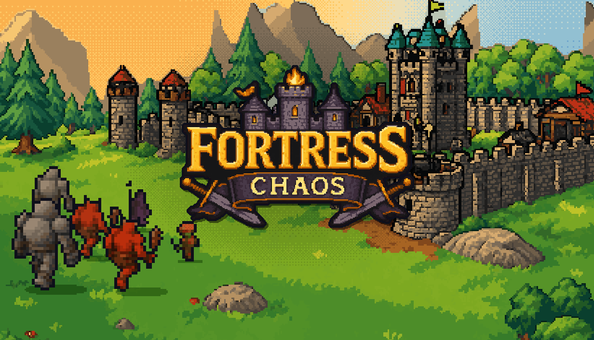<br/>
<b>⚔️ Fortress Chaos</b> — <sub>🔒 private · Alpha</sub><br/>
<sub>3D low-poly <b>roguelite</b> mixing base-building and tower-defense: raise the fortress, pick every stone, survive the chaos. Built in <b>Godot 4.7</b>.</sub>
</td>
<td width="50%" valign="top">
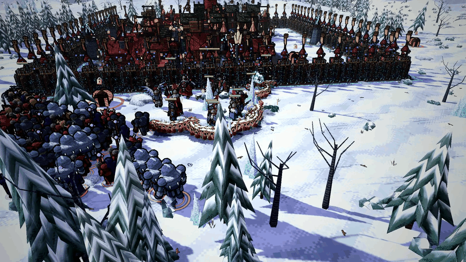<br/>
<sub>Hundreds of units on screen, campaign map with biomes, build synergies and a progression shop — real-time strategy in a stylized 3D world.</sub>
</td>
</tr>
<tr>
<td width="50%" valign="top">
<a href="https://rumor.inaciodev.online"></a><br/>
<b>🕵️ RUMOR</b> — <sub><a href="https://rumor.inaciodev.online">play live ↗</a></sub><br/>
<sub>Comic-noir <b>multiplayer detective game</b> for the classroom: explore in 3D, interrogate suspects, connect the clues on a corkboard and crack the case together.</sub>
</td>
<td width="50%" valign="top">
<a href="https://rumor.inaciodev.online"></a><br/>
<sub>And my <b>portfolio is itself a 3D first-person noir game</b> (Godot, web-exported) — walk a neon city and meet the projects in person at <a href="https://inaciodev.online">inaciodev.online</a>.</sub>
</td>
</tr>
</table>

<div align="center"></div>

<div align="center"></div>

> Security as a mindset, not an afterthought — from hardening production systems to building **authorized, local** offensive tooling to learn how attackers think.

- **Hardening in production** — SQL-injection pentest hardening, rate limiting, multi-channel **2FA**, OAuth2 / JWT, and secrets encrypted at rest
- **InacioCyber** — an **autonomous pentest agent** that runs fully **offline** and only against **targets you own or are authorized to test**: recon, enumeration, vulnerability scanning and source-repo auditing, orchestrated by a local LLM
- **Foundations** — cybersecurity coursework at FATEC-SP, plus an analytical base from mechanical-engineering research (custom Python simulations, statistical modeling)

<div align="center"></div>

<div align="center"></div>

<div align="center">

**Languages & Frameworks**


**Backend · Data · Infra**


**Cloud · DevOps · Tools · AI**


</div>

<div align="center"></div>

<div align="center"></div>

<div align="center">

<!-- Custom, self-hosted stat cards (noir-neon theme) — regenerated daily by
     .github/workflows/stats.yml, so they always render and stay current. -->
&nbsp;

<br/><br/>


</div>

<div align="center"></div>

<div align="center"></div>

<!-- JSON blocks stay left-aligned, like a real editor -->
```json
{
  "name":     "Gabriel Inácio Rodrigues Silva",
  "role":     "Software Engineer · AI Systems Builder",
  "location": "São Paulo, Brazil",
  "english":  "advanced (B2)",
  "open_to":  ["AI engineering", "architecture", "remote"],
  "status":   "building things that actually make it to production"
}
```

<div align="center">

<a href="https://inaciodev.online"></a>
<a href="https://www.linkedin.com/in/gabriel-in%C3%A1cio-rodrigues-silva-072029220/"></a>
<a href="mailto:gabrielinaciodev47@gmail.com"></a>

<sub>⌁ <i>the model interprets · the code decides</i> ⌁</sub>

</div>
