<!-- ╔════════════════════════════════════════════════════════════════╗
     ║  Gabriel Inácio · profile README · noir-neon "code editor" theme ║
     ║  Assets in /assets · SVGs generated, fonts embedded (JetBrains)   ║
     ╚════════════════════════════════════════════════════════════════╝ -->

<div align="center">

<a href="https://inaciodev.online"></a>

<br/>


<p>
  <a href="https://inaciodev.online"></a>
  <a href="https://www.linkedin.com/in/gabriel-in%C3%A1cio-rodrigues-silva-072029220/"></a>
  <a href="mailto:gabrielinaciodev47@gmail.com"></a>
  <a href="https://rumor.inaciodev.online"></a>
  
</p>

</div>

<div align="center"></div>

<br/>

<!-- ───────────────────────────── AI ───────────────────────────── -->
<div align="center"></div>

I like building real systems around LLMs, not just calling an API. That means **several agents working in parallel**, **MCP** tools, **local models running in containers**, and **AI wired into the OS and the actual work**. I let the model interpret, and keep the decisions in code.

 **How I work with AI**

- **Multi-agent orchestration**: several agents on one goal, each with its own context and tools
- **MCP (Model Context Protocol)**: custom tools and servers that give agents real capabilities
- **Local models, self-hosted**: Hugging Face embeddings and **Ollama** LLMs in **Docker**, no API bill, runs offline
- **AI wired into the machine**: desktop and OS automation, pipelines and processes driven by AI
- **LLMs in production**: OpenAI (GPT-4, Whisper) and Gemini, with prompt design, context handling and reliable **structured output**
- **AI-assisted engineering**: Claude Code and Codex in my daily workflow

```ts
const toolbox = {
  agents:   ["multi-agent", "MCP"],
  localLLM: ["HuggingFace", "Ollama"],
  runtime:  ["Docker", "Linux"],
  cloudLLM: ["GPT-4", "Whisper", "Gemini"],
  patterns: ["RAG", "embeddings",
             "structured output"],
  rule: "model interprets, code decides",
}
```

<div align="center"></div>

<!-- ─────────────────────── SOFTWARE ENGINEERING ─────────────────────── -->
<div align="center"></div>

**4+ years** building web, mobile, desktop and backend systems that actually ship. I care about more than the code: the architecture, getting it out the door, and the people around it.

<div align="center"></div>

 **What I bring**

- **Core developer and tech lead** at a Brazilian **public-procurement** SaaS company. I led a 3-dev team across **6+ large projects**, owning the architecture and sprint planning.
- Original developer of **ACL (Public Bidding Assistant)**, which automates the whole procurement lifecycle across government portals.
- **Multi-tenant SaaS** with **BFF and DDD**, plus a component library used by **20+ developers**.
- **Real-time** features over WebSockets, with deep cross-system integrations.
- Shipped a **2-week sprint in 3 days**, and led a full **Vue → React** migration in **under a week, with zero production regressions**.
- Owned **CI/CD** (GitLab CI), spec-driven development, and the full **QA → Staging → Production** path.

<div align="center"></div>

<sub>&nbsp;&nbsp;<b><a href="https://atn360.com.br">ATN360</a></b> is live; <b>BarberCore</b> and <b>OrbixHub</b> serve paying clients. <b>AirMessage</b> is a private product.</sub>

<div align="center"></div>

<!-- ───────────────────────── FEATURED PROJECTS ───────────────────────── -->
<div align="center"></div>

The builds I'm proudest of: AI systems, autonomous agents and games. They're all real, working projects, and the cards only link out where something's actually live.

####  AI and agents

<div align="center">

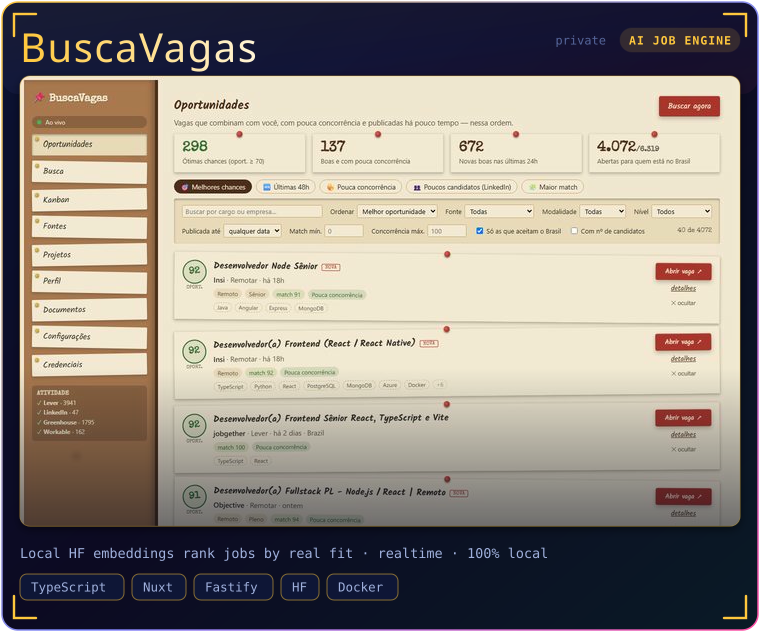
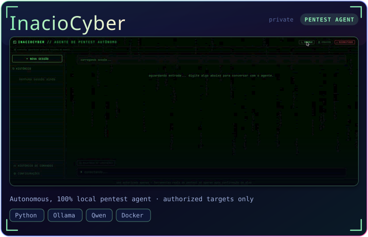
<a href="https://github.com/GabrielInacior/FormataAI">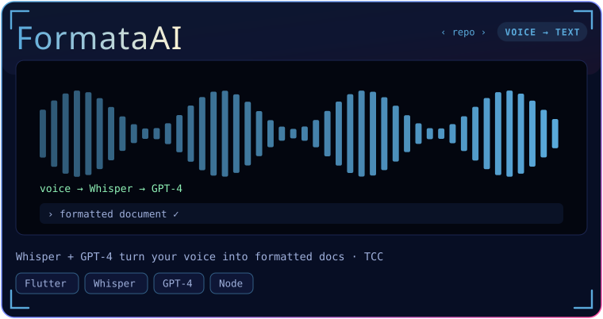</a>

<details>
<summary>&nbsp;&nbsp; <b>InacioCyber</b> · one agent, six hacker themes with CRT and VHS effects &nbsp;</summary>
<br/>
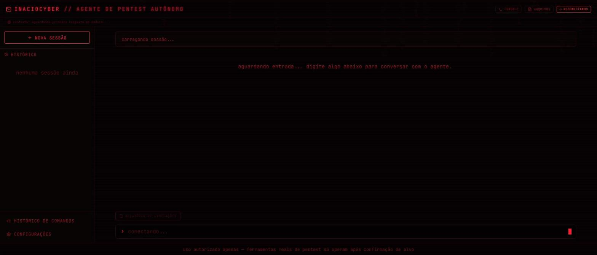
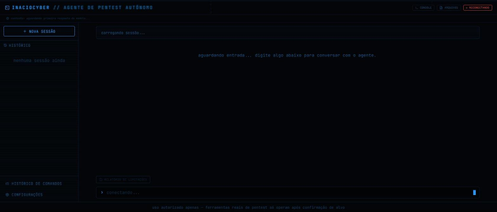
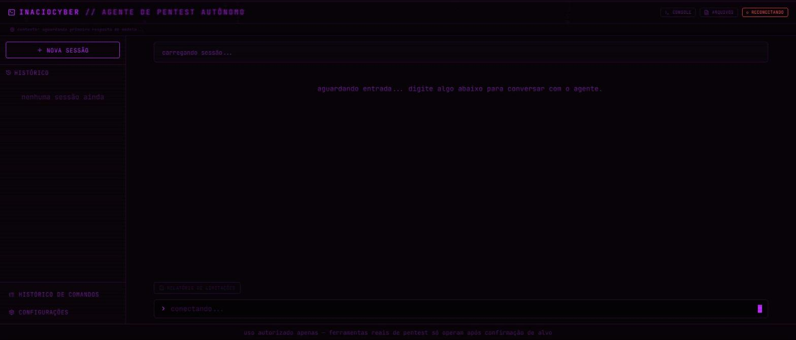
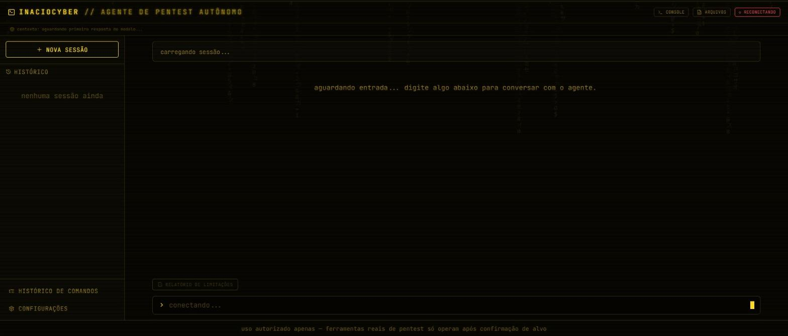
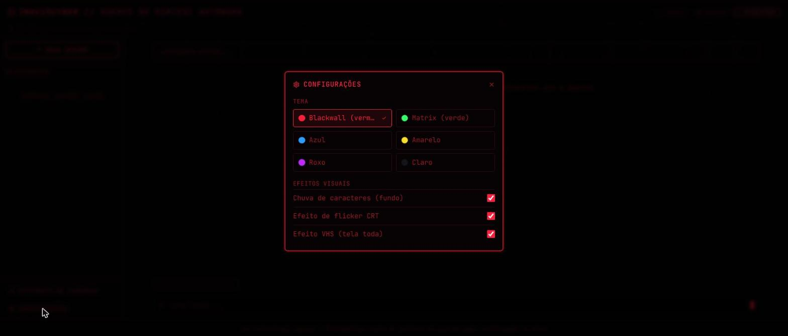
<br/>
<sub>Captured with the UI running standalone (backend offline), so some panels show loading states.</sub>
</details>

</div>

####  Games and interactive

<div align="center">

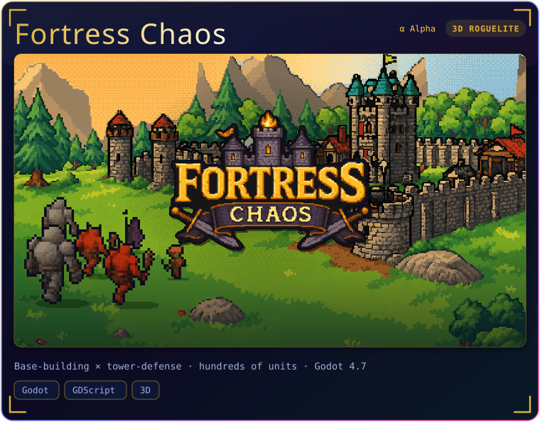
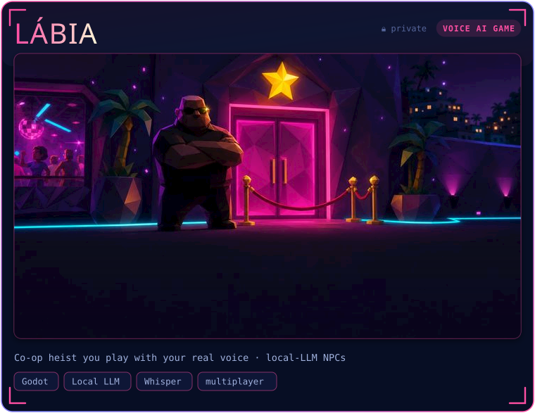
<a href="https://rumor.inaciodev.online">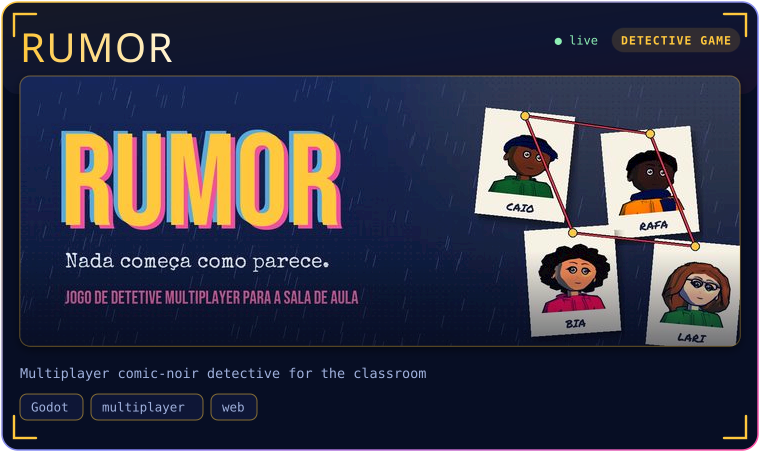</a>
<a href="https://inaciodev.online">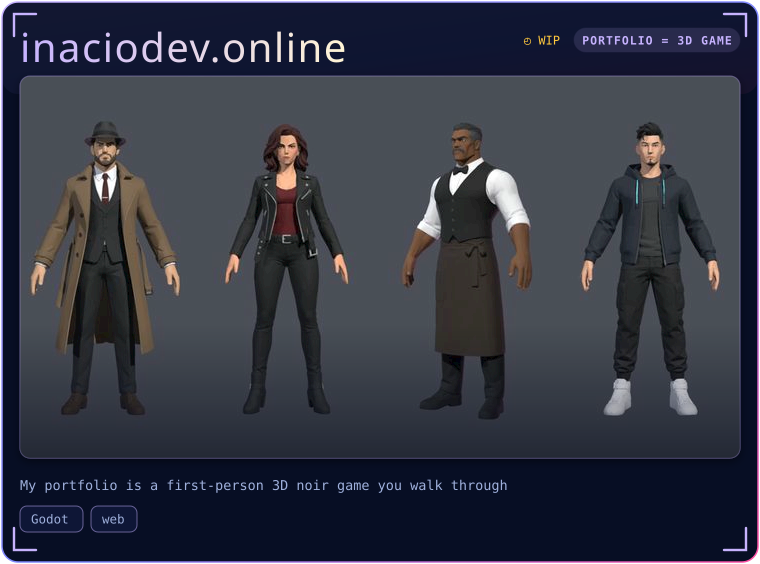</a>

<details>
<summary>&nbsp;&nbsp; more game shots &nbsp;</summary>
<br/>

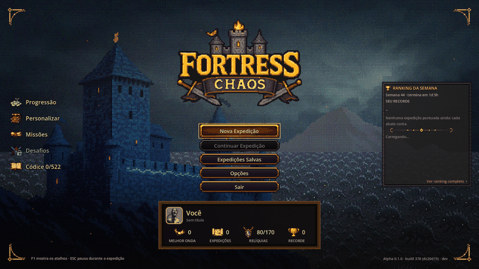
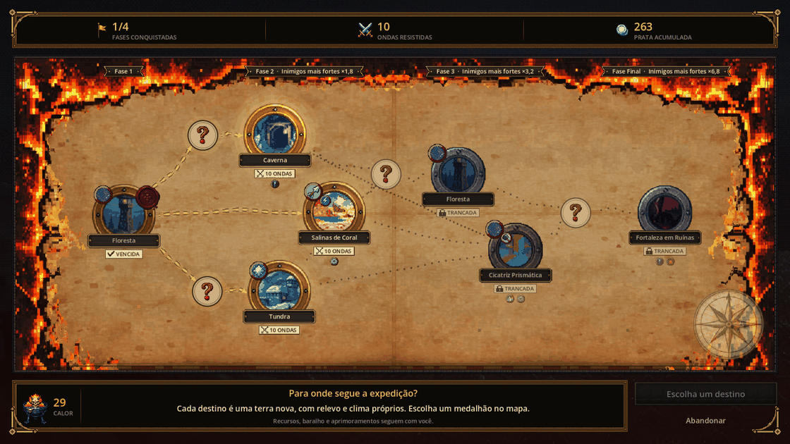
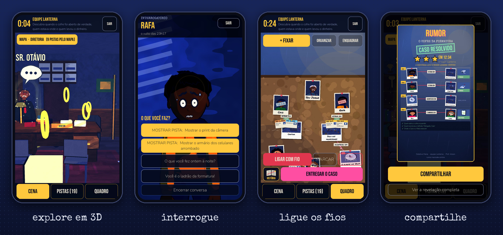
</details>

</div>

<div align="center"></div>

<!-- ───────────────────────────── SECURITY ───────────────────────────── -->
<div align="center"></div>

I treat security as part of the job, not an afterthought. That runs from hardening production systems to building **authorized, local** offensive tooling, so I understand how attackers actually think.

- **Hardening in production**: SQL-injection fixes, rate limiting, multi-channel **2FA**, OAuth2 / JWT, and secrets encrypted at rest.
- **InacioCyber**: an **autonomous pentest agent** that runs fully **offline**, and only against **targets you own or are authorized to test**. It does recon, enumeration, vulnerability scanning and source-repo auditing, all driven by a local LLM.
- **Foundations**: cybersecurity coursework at FATEC-SP, plus an analytical base from my mechanical-engineering research (custom Python simulations and statistical modeling).

<div align="center"></div>

<!-- ───────────────────────────── STACK ───────────────────────────── -->
<div align="center"></div>

<div align="center"></div>

<div align="center"></div>

<!-- ───────────────────────────── STATS ───────────────────────────── -->
<div align="center"></div>

<div align="center">

<!-- Custom, self-hosted stat cards (noir-neon theme), regenerated daily by
     .github/workflows/stats.yml, so they always render and stay current. -->


</div>

<div align="center"></div>

<!-- ───────────────────────── MORE REPOSITORIES ───────────────────────── -->
<div align="center"></div>

Beyond the featured builds, my account has **40+ repositories**: full-stack apps, CRUD systems, mobile apps and UI experiments. Here's a sample, and every link goes to a public repo.

 **Full-stack and CRUD apps**
[FatecTeams](https://github.com/GabrielInacior/FatecTeams) ·
[CrudSpringInacio](https://github.com/GabrielInacior/CrudSpringInacio) ·
[OficinaInacioAdriano](https://github.com/GabrielInacior/OficinaInacioAdriano) ·
[gerenciador](https://github.com/GabrielInacior/gerenciador) ·
[dashboard](https://github.com/GabrielInacior/dashboard) ·
[EudBudgetProject](https://github.com/GabrielInacior/EudBudgetProject) ·
[AllProjects](https://github.com/GabrielInacior/AllProjects) ·
[PadariaInacio](https://github.com/GabrielInacior/PadariaInacio) ·
[ProjetoSilvio](https://github.com/GabrielInacior/ProjetoSilvio) ·
[ProjetoJamesFatec](https://github.com/GabrielInacior/ProjetoJamesFatec)

 **Mobile (Flutter)**
[AppFatec](https://github.com/GabrielInacior/AppFatec) ·
[AnkiAna](https://github.com/GabrielInacior/AnkiAna) ·
[fatec_boer_app](https://github.com/GabrielInacior/fatec_boer_app)

 **Web and UI**
[PortfolioFatec](https://github.com/GabrielInacior/PortfolioFatec) ·
[sorvetes-inacio-pastel-ui](https://github.com/GabrielInacior/sorvetes-inacio-pastel-ui) ·
[Parallax-Personal-Website](https://github.com/GabrielInacior/Parallax-Personal-Website) ·
[Site-Fatec](https://github.com/GabrielInacior/Site-Fatec)

 **Desktop and .NET**
[ForecastTracker](https://github.com/GabrielInacior/ForecastTracker) ·
[.Net-Calculator](https://github.com/GabrielInacior/.Net-Calculator) ·
[Marcador-de-Truco](https://github.com/GabrielInacior/Marcador-de-Truco)

<div align="center">
<a href="https://github.com/GabrielInacior?tab=repositories"></a>
</div>

<div align="center"></div>

<!-- ───────────────────────────── CONNECT ───────────────────────────── -->
<div align="center"></div>

<!-- JSON blocks stay left-aligned, like a real editor -->
```json
{
  "name":     "Gabriel Inácio",
  "role":     "Software Engineer · AI",
  "location": "São Paulo, Brazil",
  "english":  "advanced (B2)",
  "open_to":  ["AI engineering",
               "architecture", "remote"],
  "status":   "shipping to production"
}
```

<div align="center">

<a href="https://inaciodev.online"></a>
<a href="https://www.linkedin.com/in/gabriel-in%C3%A1cio-rodrigues-silva-072029220/"></a>
<a href="mailto:gabrielinaciodev47@gmail.com"></a>


<sub>⌁ <i>the model interprets · the code decides</i> ⌁</sub>

</div>
